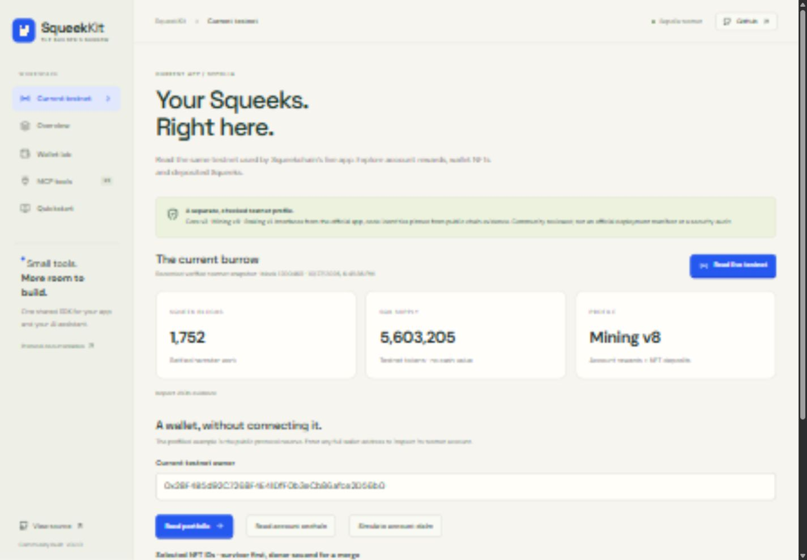

# SqueekKit 🐹

**A community TypeScript SDK, MCP server and working demo for Squeekchain.**

[](https://github.com/formless0/squeekkit/actions/workflows/ci.yml) · [Demo walkthrough](docs/DEMO.md) · [Compatibility report](docs/COMPATIBILITY.md) · [SDK reference](docs/SDK.md) · [MCP setup](packages/mcp/README.md)



SqueekKit turns Squeekchain's published ABI, deployment and integration rules into reusable tools. An app and an AI assistant share the same deployment checks, integer accounting, eligibility logic and transaction preparation.

**Community built; not official or endorsed. Sepolia only. No private keys, signing or transaction broadcasting. Packages are built locally and are not published to npm.**

## Try it

Requires Node.js **22.12+** and npm. The default read-only endpoints need no API key.

```sh
git clone https://github.com/formless0/squeekkit.git
cd squeekkit
npm ci
npm run check
npm run dev
```

Open the local URL printed by Vite. **Current testnet** is the default screen: live verified reads, real wallet/deposited-NFT portfolios and unsigned claim/merge simulations. The older documented deployment and the explicitly simulated merge lab remain separate. Saved snapshots are labeled recorded until refreshed.

## What is included

| Package                          | Purpose                                                                                                                                                                    |
| -------------------------------- | -------------------------------------------------------------------------------------------------------------------------------------------------------------------------- |
| [`@squeekkit/sdk`](packages/sdk) | Typed chain reads, strict deployment verification, diagnostic audits, API compatibility and complete portfolio reads, merge eligibility, unsigned claim/merge preparation. |
| [`@squeekkit/mcp`](packages/mcp) | Nineteen tools, three resources and a wallet-checkup prompt over stdio. Nine current-app tools plus ten legacy tools use the same SDK.                                     |
| [`@squeekkit/demo`](apps/demo)   | Responsive React playground with provenance, a live audit, simulated merge scenarios, SDK request/response previews and setup instructions.                                |

## Current compatibility — read this first

**v0.2.0 adds an explicit current-app profile that works with the live Sepolia site.** Choose the integration deliberately:

| Client                                                   | Deployment                                                         | Status                                                                                         |
| -------------------------------------------------------- | ------------------------------------------------------------------ | ---------------------------------------------------------------------------------------------- |
| `createCurrentTestnet()` / `current_testnet_*` MCP tools | Official app's Oct 24 test economy: Core v3, Mining v8, Staking v1 | Live protocol/account reads, complete portfolio and unsigned claim/merge simulations verified. |
| `createSqueekKit()` / original unprefixed MCP tools      | Developer docs' Core v3 / Mining v6 record                         | Preserved unchanged. Current strict checks detect the drift below.                             |

The current-app profile is **community-observed and reviewed**, with ABI interfaces extracted as static data from the official app, recorded source hashes, pinned runtime identities, governance, configuration and contract links. It is **not an official deployment manifest or security audit**. It does not automatically trust addresses returned by an API. [Current profile, supported operations and evidence](docs/CURRENT_TESTNET.md).

On **October 27, 2026**, live checks found:

- The documented proxy code identities and contract connections still matched, but the onchain **reporter differed from the manifest**. Strict verification and action preparation correctly reject that drift.
- The public API was serving a **different core deployment**. Its mining-state endpoint returned 404. The SDK refuses to combine those responses with the pinned economy.
- `chain.auditProtocol()` still provides a diagnostic read after code/ABI/link checks, with **`snapshot.verified: false` and explicit configuration differences**. It never enables transaction preparation.

Those findings concern the **legacy** profile. Its saved audit does not claim a successful live action. The new current-app profile separately passed real `eth_call` claim and merge simulations for the public protocol reserve. The reserve claim paid zero in simulation; the merge simulation succeeded. Neither was signed or broadcast. [Legacy evidence](docs/COMPATIBILITY.md) · [Current live receipts](docs/evidence/current-testnet-live.json).

## SDK example

After building, workspace packages resolve locally:

```ts
import { createCurrentTestnet, CURRENT_TESTNET, stringify } from '@squeekkit/sdk';

const squeek = createCurrentTestnet();
const protocol = await squeek.chain.protocol();
console.log(protocol.snapshot, protocol.core.blockHeight);

// Read-only public protocol-reserve example; no claim of wallet control.
const owner = CURRENT_TESTNET.links['nft.protocolRecipient'];
console.log(stringify(await squeek.api.portfolio(owner)));
console.log(stringify(await squeek.chain.account(owner)));

// Current rewards belong to the account, so no NFT IDs are passed to claim.
const prepared = await squeek.chain.prepareClaim(owner);
console.log(prepared.recipient, stringify(prepared.bundle));
// This only simulates. Only the actual owner can approve/sign in their wallet.
```

All action inputs are re-read onchain at a fresh, verified block; simulation uses that same block. A final canonical-block and freshness check runs before returning a bundle. State can still change before inclusion, so re-prepare immediately before signing.

## MCP setup

After `npm run build`, add this to a compatible client's MCP server configuration. Replace the path with the **absolute** checkout path (Windows accepts forward slashes).

```json
{
  "mcpServers": {
    "squeekkit": {
      "command": "node",
      "args": ["/absolute/path/to/squeekkit/packages/mcp/dist/cli.js"]
    }
  }
}
```

Try: **“Use current_testnet_status, then inspect my account and deposited NFTs. Include source blocks and do not sign or send anything.”**

The agent skill published by Squeekchain teaches an agent the protocol. This MCP server complements it with callable, tested operations. The MCP layer cannot accept keys, sign, broadcast or invoke arbitrary RPC methods. The tool inspector in the web demo calls the underlying SDK; `npm run test:mcp` tests the actual stdio transport.

## Verification

```sh
npm run check          # strict types, unit/integration tests, builds, real MCP stdio smoke
npm run test:coverage  # SDK + MCP coverage report
npx playwright install chromium
npm run test:browser   # deterministic desktop/mobile browser regressions
npm run test:live      # optional real network compatibility check (never sends)
npm run test:live:current # current app reads + unsigned claim/merge simulations
```

`test:live` writes `docs/evidence/live-verification.json` and intentionally exits nonzero if strict deployment verification fails. Live availability is not required for deterministic CI. See [TESTING.md](docs/TESTING.md) for the test matrix and limits.

## Design choices

- **One block per snapshot:** hash, number, timestamp and deployment travel with chain results; reorgs invalidate the read.
- **Big integers throughout:** no floating-point accounting. Current account rewards and legacy per-NFT rewards remain separate.
- **Owner/custody checks:** every explicitly selected NFT is checked onchain, including its staking depositor where applicable. Deposits require existing approvals; the toolkit does not grant approvals.
- **Merge intent is explicit:** survivor and donor order is preserved, with a permanent-burn warning in the output.
- **No silent migration:** changed implementations, layouts, governance or deployment links stop verification. Diagnostic configuration drift is marked unverified.
- **API uncertainty stays uncertainty:** unavailable, wrong-deployment, incomplete pagination and malformed data never become a zero balance. Retries are bounded and honor short `Retry-After` values; longer delays are surfaced to callers.

## Scope

This release supports current-app Genesis NFTs and account rewards, plus the older documented Squeeks collection (`collection = 0`). Current NFT deposits/withdrawals are supported; SQK stake/unstake, clones, gacha, minting, autonomous keepers, arbitrary contracts and a full event indexer are outside this release. **No mainnet support.** It is not an audited financial product and makes no promise of whitelist eligibility.

## Contributing

See [CONTRIBUTING.md](CONTRIBUTING.md), [SECURITY.md](SECURITY.md), [third-party notices](THIRD_PARTY_NOTICES.md) and the [WL submission draft](docs/SUBMISSION.md). Original SqueekKit code is MIT licensed.
