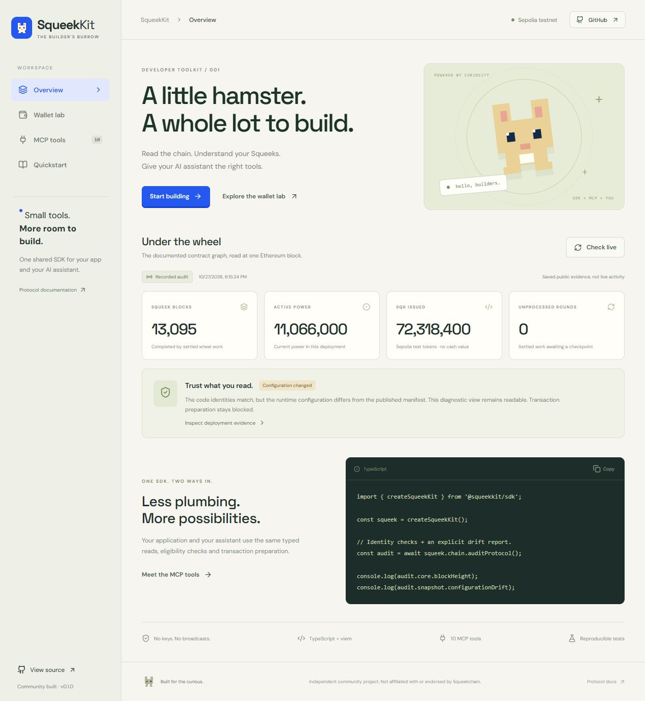

# SqueekKit 🐹

**A community TypeScript SDK, MCP server and working demo for Squeekchain.**

[](https://github.com/formless0/squeekkit/actions/workflows/ci.yml) · [Demo walkthrough](docs/DEMO.md) · [Compatibility report](docs/COMPATIBILITY.md) · [SDK reference](docs/SDK.md) · [MCP setup](packages/mcp/README.md)



SqueekKit turns Squeekchain's published ABI, deployment and integration rules into reusable tools. An app and an AI assistant share the same deployment checks, integer accounting, eligibility logic and transaction preparation.

**Community built; not official or endorsed. Sepolia only. No private keys, signing or transaction broadcasting. Packages are built locally and are not published to npm.**

## Try it

Requires Node.js **22.12+** and npm. The default read-only endpoints need no API key.

```sh
git clone https://github.com/formless0/squeekkit.git
cd squeekkit
npm ci
npm run check
npm run dev
```

Open the local URL printed by Vite. The demo includes a recorded public audit, a live diagnostic read, an interactive simulated merge lab, direct owner/ID inspection, and an MCP tool preview. Simulated examples are explicitly labeled and do not produce real transaction bundles.

## What is included

| Package                          | Purpose                                                                                                                                                                    |
| -------------------------------- | -------------------------------------------------------------------------------------------------------------------------------------------------------------------------- |
| [`@squeekkit/sdk`](packages/sdk) | Typed chain reads, strict deployment verification, diagnostic audits, API compatibility and complete portfolio reads, merge eligibility, unsigned claim/merge preparation. |
| [`@squeekkit/mcp`](packages/mcp) | Ten tools, two resources and a wallet-checkup prompt over stdio. Uses the same SDK.                                                                                        |
| [`@squeekkit/demo`](apps/demo)   | Responsive React playground with provenance, a live audit, simulated merge scenarios, SDK request/response previews and setup instructions.                                |

## Current compatibility — read this first

This release pins the **officially documented Core v3 / Mining v6 Sepolia record**, `squeeks-sepolia-core3-mining6-001`. It does not silently target other contract deployments.

On **October 27, 2026**, live checks found:

- The documented proxy code identities and contract connections still matched, but the onchain **reporter differed from the manifest**. Strict verification and action preparation correctly reject that drift.
- The public API was serving a **different core deployment**. Its mining-state endpoint returned 404. The SDK refuses to combine those responses with the pinned economy.
- `chain.auditProtocol()` still provides a diagnostic read after code/ABI/link checks, with **`snapshot.verified: false` and explicit configuration differences**. It never enables transaction preparation.

The demo's saved audit is genuine public evidence, **not a successful live claim or merge**. Positive preparation paths are tested against controlled RPC fixtures. We did not send transactions. [Full evidence and remediation](docs/COMPATIBILITY.md).

## SDK example

After building, workspace packages resolve locally:

```ts
import { createSqueekKit, stringify } from '@squeekkit/sdk';

const squeek = createSqueekKit();

// Diagnostic read, with changed configuration surfaced explicitly.
const audit = await squeek.chain.auditProtocol();
console.log(stringify(audit));

// Strict read: rejects any mismatch with the bundled deployment.
const verified = await squeek.chain.protocol();
console.log(verified.core.blockHeight); // bigint

// Explicit owner and NFT selection; no API data is reused for signing.
// Once the deployment matches, this simulates and returns an unsigned bundle.
const prepared = await squeek.chain.prepareClaim(ownerAddress, ['8889', '8890']);
console.log(stringify(prepared.bundle));
// The owner reviews and signs using their own wallet integration.
```

All action inputs are re-read onchain at a fresh, verified block; simulation uses that same block. A final canonical-block and freshness check runs before returning a bundle. State can still change before inclusion, so re-prepare immediately before signing.

## MCP setup

After `npm run build`, add this to a compatible client's MCP server configuration. Replace the path with the **absolute** checkout path (Windows accepts forward slashes).

```json
{
  "mcpServers": {
    "squeekkit": {
      "command": "node",
      "args": ["/absolute/path/to/squeekkit/packages/mcp/dist/cli.js"]
    }
  }
}
```

Try: **“Audit Squeekchain's documented deployment. Explain any mismatches and include the source block.”**

The agent skill published by Squeekchain teaches an agent the protocol. This MCP server complements it with callable, tested operations. The MCP layer cannot accept keys, sign, broadcast or invoke arbitrary RPC methods. The tool inspector in the web demo calls the underlying SDK; `npm run test:mcp` tests the actual stdio transport.

## Verification

```sh
npm run check          # strict types, unit/integration tests, builds, real MCP stdio smoke
npm run test:coverage  # SDK + MCP coverage report
npx playwright install chromium
npm run test:browser   # deterministic desktop/mobile browser regressions
npm run test:live      # optional real network compatibility check (never sends)
```

`test:live` writes `docs/evidence/live-verification.json` and intentionally exits nonzero if strict deployment verification fails. Live availability is not required for deterministic CI. See [TESTING.md](docs/TESTING.md) for the test matrix and limits.

## Design choices

- **One block per snapshot:** hash, number, timestamp and deployment travel with chain results; reorgs invalidate the read.
- **Big integers throughout:** no floating-point accounting. Per-NFT rewards and batch-rounded claimable rewards are distinct.
- **Owner checks:** NFT approval is insufficient for claims/merges. Every explicitly selected ID is checked; none are silently removed.
- **Merge intent is explicit:** survivor and donor order is preserved, with a permanent-burn warning in the output.
- **No silent migration:** changed implementations, layouts, governance or deployment links stop verification. Diagnostic configuration drift is marked unverified.
- **API uncertainty stays uncertainty:** unavailable, wrong-deployment, incomplete pagination and malformed data never become a zero balance. Retries are bounded and honor short `Retry-After` values; longer delays are surfaced to callers.

## Scope

This initial release supports the documented Squeeks collection (`collection = 0`). It does not support mainnet, staking/deposits from other test deployments, minting, autonomous keepers, arbitrary contracts or a full event indexer. It is not an audited financial product and makes no promise of whitelist eligibility.

## Contributing

See [CONTRIBUTING.md](CONTRIBUTING.md), [SECURITY.md](SECURITY.md), [third-party notices](THIRD_PARTY_NOTICES.md) and the [WL submission draft](docs/SUBMISSION.md). Original SqueekKit code is MIT licensed.
